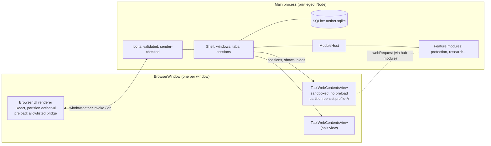

# AETHER architecture

Status: describes what is implemented in `apps/desktop` and `packages/*` as of v0.1.0. Items marked **planned** are not built yet.

## 1. Engine decision

| Option | Website compatibility | Isolation model | Blocking / extensions | Cost to maintain | Verdict |
|---|---|---|---|---|---|
| **Electron 38 + `WebContentsView`** | Current Chromium (M140) | Per-tab renderer processes, Chromium sandbox, per-partition sessions | `session.webRequest` (one listener per event per session), partial Chrome extension API | Upgrade Electron every ~8 weeks | **Chosen** |
| CEF | Current Chromium | Same as Chromium | Full request interception, no extension API to speak of | C++ host, own build, much higher integration cost | Revisit only if Electron limits bite |
| Tauri / WebView2 | Edge's Chromium on Windows, WebKit elsewhere | Webview per window, no per-tab process control | No request API comparable to webRequest; ad blocking and per-profile partitions are awkward | Small binaries, but the browser features we need are the hard part | Rejected: it is a webview toolkit, not a browser engine host |
| Chromium fork | Best | Best | Best | Requires a dedicated team and build farm | Out of scope |

Electron gives real Chromium compatibility (Google Search, Google Docs, IEEE Xplore, university SSO portals, the PDF viewer) and genuine storage partitions, which the multi-profile requirement depends on. Its weaknesses are accepted and documented in the threat model: Google may still treat Electron-based browsers as "embedded" for sign-in, extension support is partial, and we inherit Electron's release cadence.

## 2. Process and trust layout



- **Main process** holds all state. It owns windows, tabs, sessions, the database and the modules.
- **Browser UI** (`src/renderer`) is a React app loaded from `file://` into the window's own WebContents. It runs sandboxed with context isolation, in its own `aether-ui` partition whose network requests are cancelled except for app files. Its only capability is `window.aether`, a frozen bridge with an allowlist of channels (`src/preload/ui.ts`). It renders chrome (tabs, toolbar, sidebar, menus) and reports the rectangle where web content should appear.
- **Web content** runs in `WebContentsView`s layered over that rectangle. Each view is `sandbox: true`, `contextIsolation: true`, `nodeIntegration: false`, `webviewTag: false`, has **no preload**, and uses its profile's session. Pages cannot reach the bridge; the e2e suite asserts `typeof window.aether === 'undefined'` in a page.
- **Internal pages** (`aether://newtab`, `aether://about`, `aether://blocked`, module pages such as `aether://intervention` and `aether://activity`) are served by a per-session protocol handler into ordinary sandboxed views with a no-script CSP. They have no IPC; actions are plain GET links answered with redirects.

Popovers (profile menu, workspaces, command palette, address-bar suggestions) would be hidden under the views, so while one is open the main process captures the visible views, hides them, and the UI paints the captures underneath the popover. Closing the popover shows the live views again.

## 3. Profiles, windows, workspaces

| Concept | What it is | Boundary |
|---|---|---|
| Profile | A browsing identity: own Electron partition `persist:profile-<uuid>` (cookies, cache, localStorage, IndexedDB, service workers, permissions) plus own history, bookmarks, downloads, workspaces, settings rows | **Security/storage boundary** |
| Private window | Fresh in-memory partition `private-<uuid>` per window, discarded and wiped on close; no history, no session saving | Storage boundary |
| Window | A `BrowserWindowController`: its own tabs, split state, geometry, optional workspace binding. Many windows per profile share that profile's session | UI boundary only |
| Workspace | A named research context inside one profile: tabs (with reading positions), active tab, notes | Organisation only, not security |

Several Google accounts inside one profile work as they do in Chrome (Google's own account switcher). Separate profiles give full isolation.

### Session restore and "keep this window"

- Every non-private window checkpoints itself to `window_sessions` (state `open`) 1.5 s after any change and every 30 s for scroll positions, so a crash loses at most seconds.
- Closing a window asks *Keep this window for next time?* (`Keep and close` / `Close without keeping` / `Cancel`, with *Remember my choice for this profile*). Kept windows become state `saved`.
- Starting AETHER reopens all `open` and `saved` windows of profiles with *Reopen on start* enabled. Opening a profile from the profile menu reopens its kept windows if none are open.
- Restored tabs start **asleep** (no renderer) except the visible ones; they load on first activation and then scroll back to the saved position.
- Switching a window to another workspace first snapshots the current tabs (into the current workspace, or into a kept "Unsorted tabs" window if it had none), so nothing is lost.

## 4. Lightweight and crash-proof by design

- Lazy tabs on restore; memory saver puts background tabs to sleep after 20 minutes (configurable, never for audible tabs or tabs with DevTools open).
- One process per tab (Chromium); a crashed tab shows a recovery screen, other tabs are unaffected. A crashed UI renderer is reloaded automatically; state lives in main.
- Main-process `uncaughtException`/`unhandledRejection` are logged to `userData/logs/aether.log` instead of killing the app. Module failures (activation, listeners, interceptors) are isolated and logged.
- Corrupt database on start: renamed aside and a fresh one is created.
- No background services, no telemetry, no update pings in v0.1. The only network traffic AETHER itself causes is favicon fetches (through the profile session), filter-list downloads by the protection module, and Chromium's spellcheck dictionary download.
- No native Node modules: storage uses `node:sqlite`, which ships inside Electron, so there is nothing to rebuild per Electron version.

## 5. Source map

```
apps/desktop/
  src/main/index.ts          app lifecycle, single instance, hardening, logging
  src/main/shell.ts          windows registry, restore, profiles, permissions, tab API for modules
  src/main/window.ts         one window: tabs, split, layout, shortcuts, close prompt, persistence
  src/main/tab.ts            one tab: lazy WebContentsView, sleep/wake, scroll capture
  src/main/sessions.ts       profile/private partitions, UA, permissions, aether:// handler
  src/main/ipc.ts            every privileged IPC handler, validated
  src/main/module-host.ts    module runtime implementing @aether/plugin-api
  src/main/downloads.ts      per-profile downloads
  src/main/internal-pages.ts aether:// pages
  src/preload/ui.ts          the bridge (UI only)
  src/renderer/              React UI
  test/e2e/run.mjs           Playwright-for-Electron end-to-end suite
packages/plugin-api          types-only module contract
packages/storage             SQLite schema, migrations, repositories
packages/omnibox             address-bar parsing and bang shortcuts
packages/web-request-hub, privacy, focus, activity, protection-module   privacy/focus/time tracking (sibling work)
```
