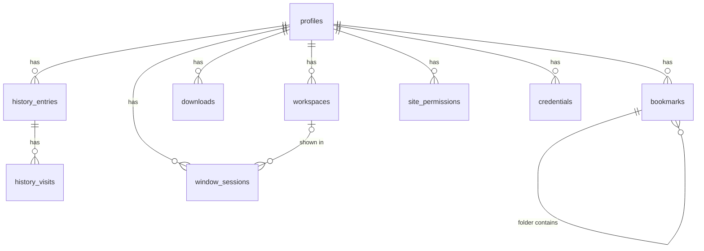

# Data model

All AETHER data lives on the user's device in `%APPDATA%/AETHER/` (Windows; `userData` in Electron terms):

| Location | Contents |
|---|---|
| `aether.sqlite` (+ `-wal`, `-shm`) | Everything AETHER itself stores (tables below) |
| `Partitions/profile-<uuid>/` | Chromium storage for one profile: cookies, cache, localStorage, IndexedDB, service workers |
| `logs/aether.log` | Local error log (never uploaded) |
| `modules/<id>/` | Files a module chooses to keep |

Private windows use in-memory partitions; nothing for them is written to disk except downloaded files the user saves.

## Core tables (`packages/storage/src/schema.ts`)

| Table | Key columns | Notes |
|---|---|---|
| `profiles` | `id` (uuid), `name`, `color`, `search_engine`, `close_behavior` (`ask`/`save`/`discard`), `restore_on_startup`, `download_dir` | Partition name is derived: `persist:profile-<id>` |
| `history_entries` | `(profile_id, url)` unique, `title`, `visit_count`, `typed_count`, `last_visit_at` | Only `http(s)` URLs; frecency ranking for suggestions |
| `history_visits` | `entry_id`, `visited_at`, `transition` | Enables "clear last hour/day/week" |
| `bookmarks` | `profile_id`, `parent_id` (folder), `title`, `url` (NULL = folder), `position` | |
| `downloads` | `profile_id`, `url`, `filename`, `path`, `state`, bytes, times | In-progress rows become `interrupted` after a crash |
| `workspaces` | `id`, `profile_id`, `name`, `color`, `notes`, `tabs_json`, `active_index`, `archived` | `tabs_json` = `[{url, title, scrollY?, pinned?, pane?}]` |
| `window_sessions` | `id`, `profile_id`, `workspace_id`, `state` (`open`/`saved`), `bounds_json`, `maximized`, `tabs_json`, `active_index`, `split_json` | Crash checkpoints and windows kept on close |
| `site_permissions` | `(profile_id, origin, permission)`, `decision` | Remembered prompts |
| `credentials` (v2) | `(profile_id, origin, username)` unique, `domain` (eTLD+1, indexed), `password_enc`, `title`, `note`, `source` (`manual`/`google`/`csv`), `last_used_at` | `password_enc` is OS-encrypted (Electron `safeStorage`: DPAPI on Windows). Plaintext never reaches the database. Matched to pages by registrable domain; an `https` login never fills on an `http` page |
| `settings` | `key`, `value_json` | App-wide settings (including `theme`), per-profile inbox notes (`inbox:<profileId>`) |
| `module_kv` | `(module_id, profile_id, key)`, `value_json` | Module key/value store |
| `schema_migrations` | `(owner, version)` | `core` and `module:<id>` owners |

Module-owned tables (examples): `protection_kv`, `activity_segments`, `activity_interventions`, `activity_focus_sessions`, `research_*`.

## Deletion and export

- **Delete profile** shows counts of what will go, then: closes its windows, clears the partition (cookies, storage, cache, auth cache), deletes all rows (cascade), emits `profileDeleted` so modules delete theirs, and removes the partition folder on next start (Windows locks it while the session object lives). Downloaded files are not touched.
- **Export profile** writes JSON with the profile, bookmarks, history, workspaces and download list. Cookies and site data are not exported (they are Chromium's, and exporting sign-in cookies would be a credential leak).
- **Passwords** are deleted with their profile (cascade). Export writes a Google/Chrome-format CSV after a plain-text warning; the file is created with owner-only permissions where the OS supports it.
- **Clear history** by hour, day, week or everything; "everything" also clears that profile's HTTP cache.
